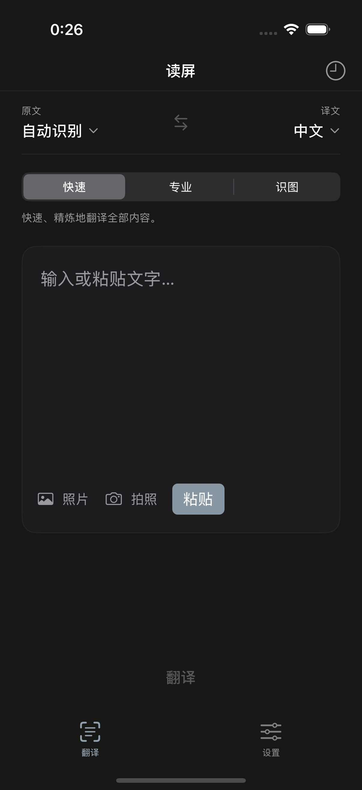
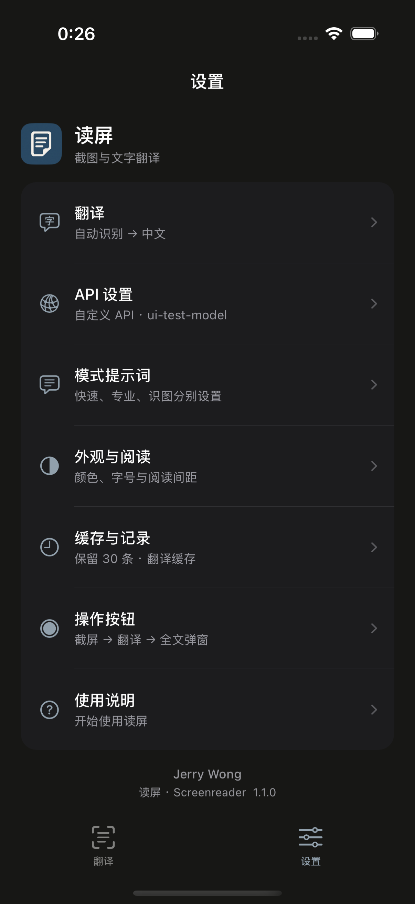
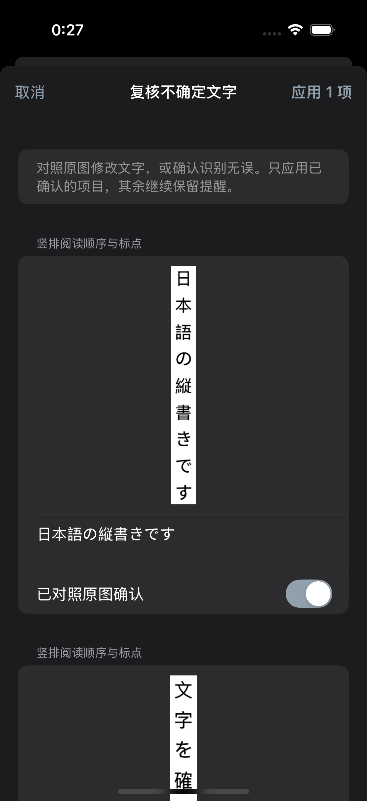
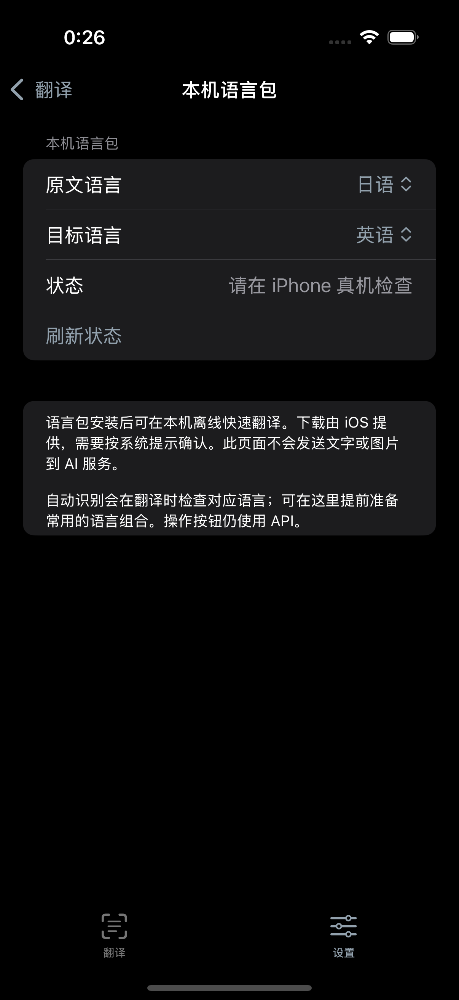

# 读屏 1.1.0 验证报告

验证日期：2026-10-07（日本时间）。版本 **1.1.0**，构建 **18**，署名 **Jerry Wong**。

## 结果

| 范围 | 最终结果 |
|---|---|
| Swift 核心测试 | 134 项通过，0 失败 |
| iOS 单元与集成测试 | 197 个不同用例最终通过，0 未解决失败 |
| iOS 界面测试 | 31 个不同用例最终通过，0 未解决失败 |
| iPhoneOS Release | 构建成功，最终 Release 日志无编译警告 |
| IPA 校验 | arm64、未签名、ZIP CRC 正常、版本与构建号正确 |

iOS 的 197 项包含核心测试。iOS 和 UI 数字来自完整回归与定向复测，按用例取最后一次结果，不是把重复执行次数相加。完整回归中两项旧断言需要适配：识图准备耗时改用准备阶段字段，复核开关测试需点击实际开关。定向复测的 15 项单元／集成和 3 项 UI 均通过。完整逐项结果见 [validation.json](validation.json)。

## 已验证内容

- 翻译首页保留照片入口，新增拍照和粘贴，文件入口已移除。无相机时有提示。
- 实际界面执行复制译文、清空输入、粘贴，内容成功回到输入框；图片与文字的粘贴加载、识图拒绝纯文字由集成测试验证。
- 设置底部实际显示 Jerry Wong 和 1.1.0；内置模型指令预览已移除；自定义模式要求仍可保存。
- 使用真实 Vision 识别生成的两列直立日语，文字完整，列顺序从右到左。原图裁片可见，逐项确认后能回到原文界面。
- 低置信度、小字和竖排列入复核；只应用已确认项，未确认项继续保留提醒。
- 五列表格保留商品续行、空单元格；专业翻译保留首尾空单元格，拒绝模型擅自填入数字或占位文字。
- 320 点宽度的全文文稿中，宽表格在内部横向滚动，页面本身不被撑宽，最后一段仍可见。
- 既有日英菜单、通知、购物和票据的价格、数量、日期、末行、阅读结构及快捷指令全文窗口回归通过。
- 本机分段译文按 ID 恢复顺序，缺段或空返回会报错；本机缓存不受 API 专属配置影响；清空缓存后拒绝旧请求写回。
- 分段耗时字段、缓存命中、图片切换和原文语言切换时的识字失效处理通过测试。

## 安装包

文件：`Screenreader-iOS-v1.1.0-build18-unsigned.ipa`  
大小：2,502,933 字节（约 2.39 MiB）  
应用标识：`com.raydon.ScreenTranslate`  
最低系统：iOS 18.0  
SHA-256：`3d2b7a9d51eefee15bde468579c06937114ab6df5ac112dab3112a900ecec6d1`

安装包位于本项目 `work/release-1.1.0/`。这是未签名 IPA，需要自行签名安装。包内已验证相机权限说明、中英文显示名称、两份快捷指令和 3 个正式 App Intent；不含测试目标、调试模拟入口、开发路径或配置描述文件。

## 尚需真机验收

相机实拍及权限拒绝后的恢复、真实视觉模型上传、Apple 语言包首次下载和实际离线翻译尚未在本版真机上验收。语言包页面在模拟器明确提示使用 iPhone 检查。模拟器固定响应不代表真实模型的准确率、网络耗时或真机速度。

竖排测试为清晰生成素材；艺术字、密集注音、倾斜拍摄与复杂混排仍有识字边界。识别结果需要时可对照原图修正，或切换识图模式。

## 界面记录

以下为模拟器测试配置，API 使用固定响应，不是发布包的默认服务配置。

<table><tr><td></td><td></td></tr><tr><td></td><td></td></tr></table>

## 日志位置

- `work/release-1.1.0/core-verified.log`
- `work/release-1.1.0/regression.xcresult`
- `work/release-1.1.0/verification.xcresult`
- `work/release-1.1.0/release-verified.log`
- `work/release-1.1.0/Screenreader-iOS-v1.1.0-build18-unsigned.verification.json`
