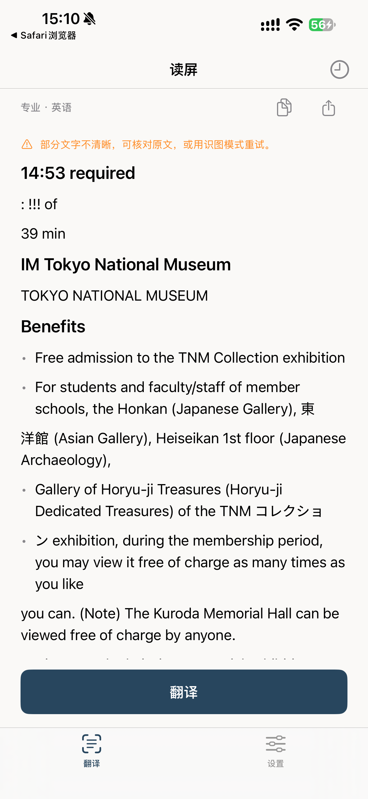
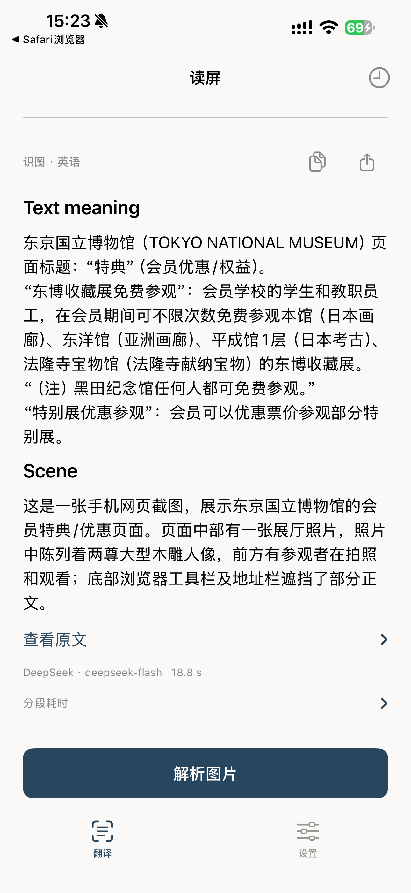
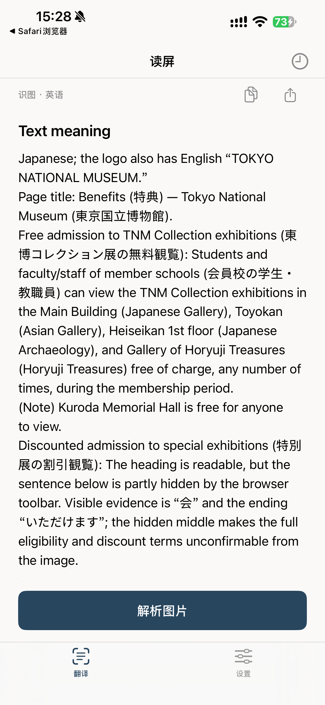

# 读屏 1.1.1（build 19）测试与修复报告

日期：2026-10-07。开发者：Jerry Wong。

## 测试边界

本次连接了 iPhone 15 Pro Max（iOS 27.2），在手机已安装的 **1.1.0（18）** 上实际操作 Safari、读屏与快捷指令，并调用手机原有的 **DeepSeek / deepseek-flash** 配置。API 密钥留在手机 Keychain，没有导出。使用的是公开网页文字和真实网页截图，不是预设模型答案。

新提示词通过旧版 App 的“识图模式要求”进行了真机对照。测试结束后恢复该自定义字段。新版 OCR、请求参数和错误处理通过源码回归验证。**本机无可用 iOS 签名证书，交付包未签名；没有把 1.1.0 的实测冒称为 1.1.1 二进制真机验收。**

## 真实网页与结果

来源：[东京国立博物馆校园会员权益页](https://www.tnm.jp/modules/r_free_page/index.php?id=167&lang=ja#tokuten)、[票价与开放时间页](https://www.tnm.jp/modules/r_free_page/index.php?id=113#ticket)。两页均在真实浏览器中核对。

手机 Safari 截图保存为 `work/release-1.1.1/physical/museum-web.png`。为重复输入同一张截图，临时局域网服务提供原文件，再由 Safari 的“复制”送入读屏；网页像素未改写。工具直接注入 PNG 时遇到一种不可读取表示，但 Safari 自己复制图片的路径成功。因此没有把注入工具失败笼统判定成所有图片粘贴都损坏。

| 场景 | 真机耗时 | 观察与结论 |
|---|---:|---|
| 专业：会员学校学生的优惠及例外条件，文字粘贴 | 2.84 秒 | 保留“部分特展”“学生”和可能不设优惠的例外，没有扩展为所有会员 |
| 专业：完整会员网页截图 | 55.42 秒 | OCR 1.28 秒，请求 54.14 秒；发现状态栏误译、正文误判列表、跨行词被拆开 |
| 识图：原提示词，同一截图 | 16.30 秒 | 能识别展厅、雕像和参观者；主要正文含义正确，但大量重复原文并使用等号 |
| 识图：增加格式与遮挡约束 | 18.79 秒 | 失败样例：选择英语却返回中文正文；特展适用人群被泛化 |
| 识图：再明确目标语言与人群边界 | 30.21 秒 | 正文恢复英语；说明底部遮挡使完整优惠条件无法确定。仍出现多余括号原文，已进一步收紧内置提示词，但不声称所有模型输出都已消除此现象 |
| 专业：票价、年龄与开放时间 | 15.01 秒 | 1,000／500 日元、购票后 2 个月、特展票仅当天通用、未满 18／70 岁以上、周日延时须次日为节假日、闭馆前 30 分钟均保留 |
| 临时截图全文快捷指令 | 两次超时 | 未产生成功译文；旧版错误窗口暴露 `timeout` 枚举名。新包改为中文错误消息；新包快捷指令仍待签名后真机复测 |

耗时是单次观测，不能当作平均性能或新版本提速倍数。网络请求不自动重试。

<table><tr>
<td></td>
<td></td>
<td></td>
</tr></table>

## 新包修复

- **日语段落**：结合左右位置、字宽、行距和句末判断连续正文，不再仅凭行高或较大行距将其识别为列表。真实截图的“東洋館”“コレクション展”“ご覧いただけます”在本机 Vision 流程中恢复为一个完整段落。真正的列表、不同列、双语商品标题及脚注仍保持分隔。
- **关键文字复核**：日期和双语标题中的明显乱码先于普通低置信度文字；标题仅裁切出错的日文部分进行两个倍率的复识别，避免重复识别整行英文和日文耗尽预算。优先为最多 4 处关键异常安排复核，不因软时间预算耗尽而跳过；自动改写仍要求两次像素识别一致。其余复核仍受时间预算和总计 8 个区域的上限约束；关键复核可能超过软时间预算，实际耗时会显示在识字阶段。预约编号等正常字母数字组合不触发这种修复，数字与文字均不凭词表猜补。
- **状态栏**：允许时钟后出现静音图标被 OCR 识成的短字符，同时要求手机比例、紧凑位置与右侧状态栏证据，避免把正文时间或数字删除。
- **重复机构名称**：相邻、对齐的中日文名称与英文名称组成一个内容块，让模型在同块内去重。
- **识图提示词**：强调所有正文使用所选语言；减少双语词典式复述、括号原文和语言介绍；区分学生、教职员与所有会员；明确遮挡内容不得猜补。图片请求本身也明确携带目标语言。
- **错误语言检查**：对英语结果中带有多个中日文句号、明显占主导的大段中日文报错，不保存为成功译文。该检查保留短姓名与术语，属于保守的明显错误检测，不是所有语言组合的完整质量判定。
- **等待优化**：DeepSeek 专业与识图明确使用 `low` 推理，快速模式继续关闭推理；按 Chat Completions、Responses、Messages 各自的协议发送参数。此前专业模式依赖服务端默认 `high`。依据：[官方思考模式文档](https://api-docs.deepseek.com/zh-cn/guides/thinking_mode/)。新参数的请求形状有测试，实际延迟改善尚未在新版签名二进制上测量。
- **粘贴和错误提示**：图片首种数据表示失败时尝试其他表示、临时文件和 UIImage；文件在有效回调期内读取；损坏图片不静默改粘网址。快捷指令将应用错误桥接为带中文说明的 NSError。
- **版本与署名**：1.1.1 / 19，Jerry Wong；延续 1.1.0 的拍照、粘贴、隐藏内部指令、竖排复核、表格、语言包和缓存功能。

## 自动验证与交付

- 核心回归：142 项通过，包括真实网页几何回归、时间正文保留、列表与分栏边界、错误语言检测、关键复核优先级和三种协议的推理参数。
- iOS 粘贴专项：3 项通过，包括首表示失败回退、临时文件生命周期、损坏图片处理。
- iOS 单元／集成：**208 个不同用例最终通过**，含上面的核心测试。统计按完整回归与定向复测的最后结果去重，并非将多轮执行次数相加。
- UI：**5 项通过**，覆盖拍照／粘贴入口、隐藏指令、Jerry Wong 署名、语言包入口、复制后粘贴、竖排原图复核、专业排版与缓存、识图及原文展开。
- 最后一轮关键 OCR／缓存专项：**15 项全部通过**，其中一个用例逐一检查 8 张菜单、购物页、登录页、交通通知、邮件、饮品照片、海报和票券图片。先前暴露的日期、预约标题和金额符号问题均复测通过。
- 回归中另修正测试自身的固定 10 秒等待：真实 Vision 在 Intel 模拟器上约需 13 秒，改为等待任务完成（上限 45 秒），并额外断言无应用错误；未放宽识别结果断言。
- 真实截图在新版本机 Vision 流程中复验，输出见 `work/release-1.1.1/museum-ocr-fixed.json`。Mac 与 iPhone 的 Vision 返回可能不同，因此另外保留了手机实际出现的 `14:53必` / `39分` 文本几何回归。
- 安装包：`work/release-1.1.1/Screenreader-iOS-v1.1.1-build19-unsigned.ipa`，iPhoneOS arm64 Release，需重签安装。打包检查版本、隐私说明、快捷指令元数据、签名状态、测试代码剔除和 ZIP 完整性，均通过。大小 2,524,594 字节。

SHA-256：`82dbfcf072a204ad1e378f0be2abdeb01b18af4da22f7c5822267c87f319a34a`。详见 [安装包校验](安装包校验.json)。

详细自动验证记录位于 `work/release-1.1.1/validation-summary.json`；最后一轮结果为 `CriticalOCR.xcresult`。当前 IPA 已替换测试期间提供的临时版本，请以本报告中的 SHA-256 为准。

测试后设置与测试前逐字段比较一致：专业模式、英语目标、自定义模式提示词为空；真实测试记录保留供核对。临时网页服务已停止，临时 qa 快捷指令已移除。

仍待真机验收：1.1.1 签名安装后的整条截图／快捷指令路径、降低推理强度后的真实速度与质量、相机实拍、语言包下载及断网本机翻译。模糊、遮挡的小字仍应通过原图复核，不保证能够恢复不可见文字。
