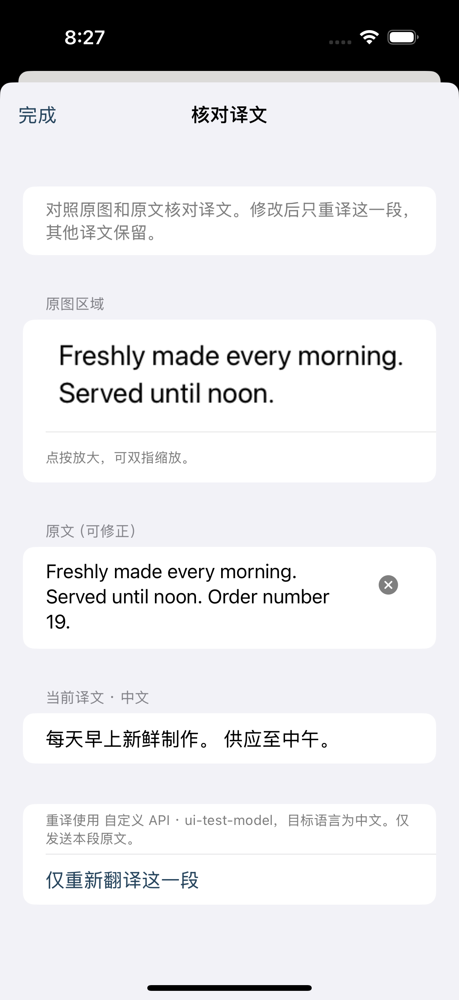
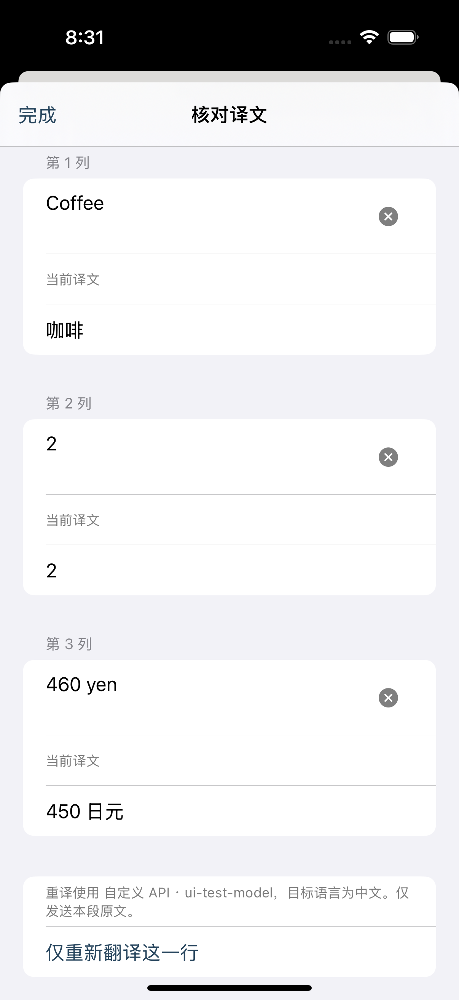

# 译文直接核对

2026-10-08 · 本次功能包含在 1.1.1 构建 20 中。

## 使用

1. 使用专业模式翻译文字或图片，点按一段译文，或点旁边的“核对”。表格可按行进入核对。
2. 对照本段原文、当前译文和原图区域。点按原图可放大，支持双指缩放、双击放大及横向移动。
3. 修正原文后，选择“仅重新翻译这一段／这一行”。翻译成功后返回全文，其余译文保留。

表格每列有独立输入框，允许修正空白单元格，保留列数和顺序。重译仍检查数字、空列以及各列的数字归属。取消或失败时，旧译文和记录保持原样，失败后的编辑草稿可继续修改并重试。

原文输入框旁提供清空按钮，便于重填整段或一个单元格。清空单元格保留该列位置；整段原文为空时会提示填写后再翻译。

修正同步到原文输入框及已有翻译记录，下次整篇翻译使用修正后的原文。核对历史译文时沿用原目标语言和可确定的原文语言，使用当前 API、模型、术语表及专业模式要求；界面说明只发送本段原文。删除的记录不会因请求迟到而恢复，旧核对窗口也不能覆盖另一处已提交的修改。

## 范围

- 原图仅在当前 App 保留图片时可查看，记录仍只保存文字和局部坐标，不保存图片。历史记录可以核对对应原文。
- 旧记录没有段落原文对应关系时，继续通过“查看原文”核对全文；重新使用专业模式翻译后可逐段核对。
- 快速模式、识图解释和快捷指令中的 HTML 文稿保持原有的全文原文查看方式。逐段核对在 App 的专业译文及对应翻译记录中提供。
- 按用户最新要求，暂缓 `RecognizeDocumentsRequest`。当前 Xcode 16.2 / iOS 18.2 SDK 可编译本次功能，无需升级 SDK。

## 实现与修复

本机 OCR 为每个阅读块保存原图范围，合并换行段落时合并范围，表格行覆盖所有单元格。此次回归发现换行单元格原先只合并文本，漏掉续行坐标；已修复，并补齐双语表头的横向范围。长截图的核对裁图与 OCR 使用同等级的 8192 像素上限，常规图片为 4096，按 EXIF 方向校正后定位。

重译复用专业模式的协议、语言检查和缓存，仅发送一个块。成功后按原块 ID 替换，保留类型、原图范围及其他块；记录该段使用的模型和耗时。全文的原始耗时标为“初次翻译”，避免把旧统计当作局部重译耗时。

修复核对弹窗与主界面键盘工具栏的同名按钮干扰，清空原文后重新聚焦编辑框。保留原文的来源状态，附带图片的手动原文不会因核对后切换语言而被当成自动识字结果清空。

## 验证

环境：macOS 14.8.8 / Xcode 16.2，iPhone 16 Pro / iOS 18.2 模拟器。模拟器测试使用临时签名以支持 Keychain；首轮误用无签名测试构建造成密钥读写失败，已调整测试签名方式。

| 验证 | 结果 |
|---|---|
| Swift Package 核心回归 | 151 项通过，含新增 9 项核对测试 |
| iOS 核对集成 | 9 项通过 |
| 段落、表格核对及原有专业界面操作 | 5 项通过（最终按用例合并） |
| iPhoneOS arm64 Release 构建 | 通过，未签名 |

集成覆盖真实 Vision 原文定位与裁图识字、EXIF 方向、长图小字分辨率、只提交选中块、历史语言保持、原文与后续整篇翻译同步、历史与主界面同步、进行中取消、HTTP 401、数字错误、并发修改冲突、删除记录及关闭保存记录。

原图与识字测试调用 Apple Vision；网络与 UI 测试使用确定性的测试响应验证请求范围和状态变化。本次未进行新增功能的签名真机安装或在线模型翻译质量测试。

详细日志及结果包位于 `work/translation-review/`，最终汇总见该目录的 `validation-summary.json`。

最终共 165 项独立用例通过。UI 首轮的重名定位、部分可见控件和文本光标问题保留在诊断结果中；最终操作使用明确的弹窗范围、清空输入以及完整可见的控件。

## 安装包

`work/release-1.1.1-build20/Screenreader-iOS-v1.1.1-build20-unsigned.ipa`，1.1.1 / 构建 20，2,621,086 字节，iPhoneOS arm64，最低 iOS 18。需要自行签名安装。相机说明、快捷指令元数据、无签名状态、测试入口剔除、开发路径剔除及 ZIP CRC 均通过检查。

SHA-256：`71a27cc013fb3347b04bac3f9ba900041d969878aeffcdddbb5c753675cb32fe`。此前构建 19 安装包保留。

## 界面样例（模拟器测试配置）

<table><tr><td></td><td></td></tr></table>
