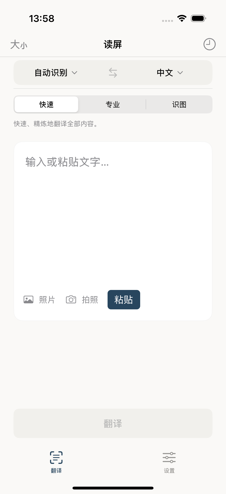
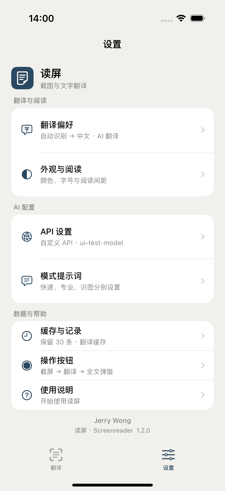
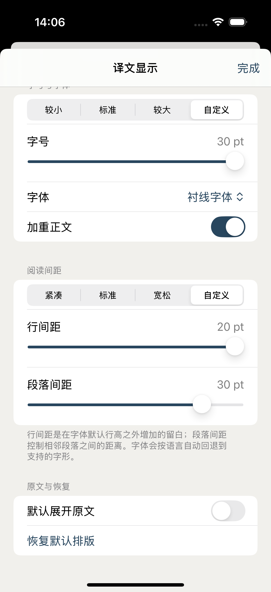

# 读屏 1.2.0（构建 21）

## 本次更新

1. **中文默认目标语言**：首次使用或旧配置缺少目标语言时，默认译为中文。已经保存的英语、日语等选择会保留。
2. **紧凑语言栏**：翻译页顶部用一行显示原文和目标语言，点按即可选择；中间按钮交换语言。自动识别时禁用交换，防止误改语言。
3. **自定义译文排版**：翻译页左上角的文字图标可打开“译文显示”，也可从“设置 → 外观与阅读 → 译文显示”进入。字号为 12–30 pt，附加行间距为 0–20 pt，段距为 0–36 pt；支持系统、衬线、圆角字体及加重正文。保留三档预设、原文默认展开和一键恢复。设置立即保存，应用于当前译文、列表、表格、历史记录及下次生成的全文窗口。字体按语言回退，网页与原生文字的实际行高可能略有差别。
4. **设置重新分组**：常用翻译偏好与阅读设置在前，随后是 API 和模式提示词，最后是缓存记录、操作按钮和使用说明。语言包放在翻译引擎下面。底部署名保持 Jerry Wong。
5. **减少重复等待**：重复导入同一图片时可跳过 Vision 识字，切换目标语言也可复用识字结果；本机翻译会将完全相同的段落合并为一次请求，再还原所有原位置、次序和空行。

## 缓存与速度边界

识字缓存仅保留文字、位置和复核信息，不保存图片数据、不落盘。最多 8 条，最长 20 分钟，并限制内存估算容量为 2 MB。图片内容、原文语言、识字方向、模式、术语或控件过滤选项变化时重新识字。用户修改后的识字文本只作用于当前文档，不写回原始识字缓存。

“设置 → 缓存与记录”显示两类缓存的条数和复用次数，可一并清除；关闭复用后两类缓存均停用。清除后，清除前启动的识字任务不能把旧结果重新写回。

这次提速主要减少重复工作。首次处理新图片仍需识字；首次 API 翻译速度仍取决于模型、输入长度及网络。本机段落去重保留完整内容，不缩短译文或跳过不确定文字复核。

## 安装

安装包：`Screenreader-iOS-v1.2.0-build21-unsigned.ipa`。平台为 iPhoneOS arm64，最低 iOS 18。当前机器没有有效 iOS 签名身份，提供未签名 Release 包，需自行重签后安装。

本次验证使用 iOS 18.2 模拟器。相机实拍、本机语言包下载和 Apple 翻译实际耗时需在签名后的 iPhone 上验收；本次没有把模拟器或本地接口桩测试视为真机、真实网络速度测试。

## 速度实测

使用 iOS 18.2 模拟器对同一张英文菜单图执行真实 Vision 识字；翻译网络使用本地 HTTP 接口桩，排除外部模型与网络等待。

| 场景 | 总耗时 | 其中识字耗时 |
|---|---:|---:|
| 第一次导入 | 2.386 秒 | 2.384 秒 |
| 重复导入、命中缓存 | 0.609 毫秒 | 0.349 毫秒 |
| 关闭缓存后重试 | 2.288 秒 | 重新运行 Vision |

首次与重复导入合计只调用一次接口，识字文本与译文保持一致。该结果是本机单个样本的缓存路径验证，不是 API 端到端速度承诺。Apple 本机翻译的去重用例将 4 个段落合并为 2 个不同的请求，再完整还原 4 个位置与空行；实际 Apple 翻译性能尚未在真机测量。

## 验证结果

- 154 项核心测试、23 项 iOS 集成测试、11 项界面检查，合计 188 个不同用例的最后结果全部通过。
- 覆盖中文默认值与旧设置迁移、字号／间距边界、设置持久化、历史阅读与 HTML 表格格式、语言快捷选择和交换、44 pt 点击区域、滑块拖动时位置稳定、预设及恢复默认、最大系统字号下滚动与署名可达。
- 真实 Vision 识字、缓存容量／过期／清除期间任务隔离、关闭缓存后重新识字，以及既有译文局部核对与失败／取消保护均通过。
- Release 设备构建通过；校验了版本、arm64 架构、最低系统版本、快捷指令资源、权限说明和 ZIP CRC，确认未包含测试代码、密钥样例或本地编译路径。
- 用例按最终结果去重，首轮的滑块拖动精度和坐标浮点比较断言已修正；拖动时预览增长造成滑块位移的问题已实际修复并单独复测。原始日志和各次 xcresult 保留在 work/release-1.2.0/。

完整用例及安装包校验见 [验证汇总](验证汇总.json)、[安装包校验](安装包校验.json)。

## 界面截图

以下为模拟器中的测试配置。

