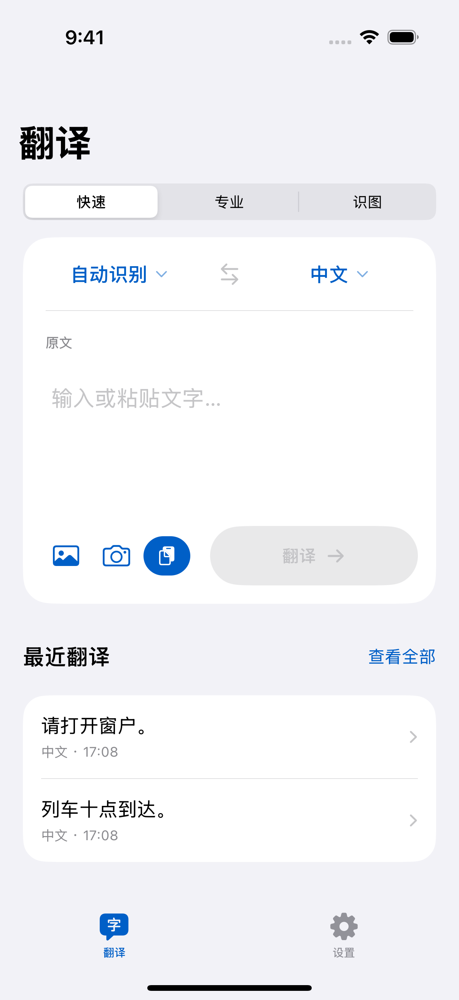
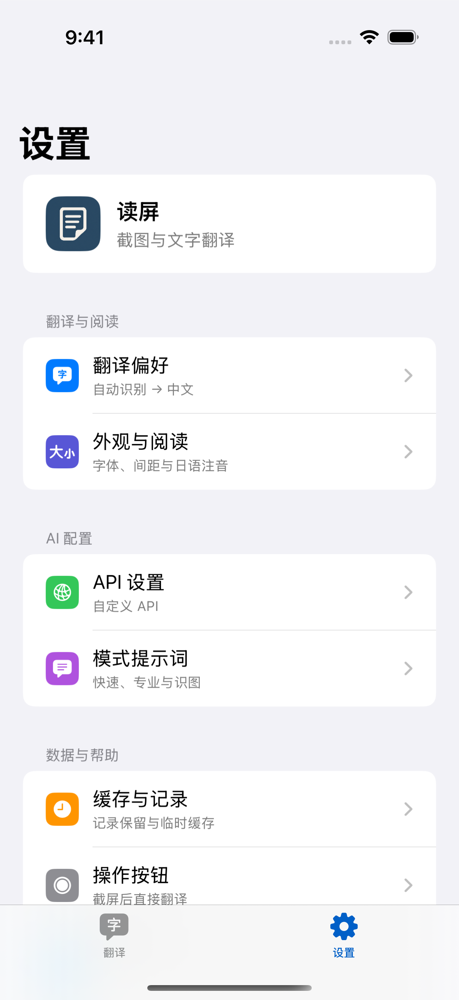
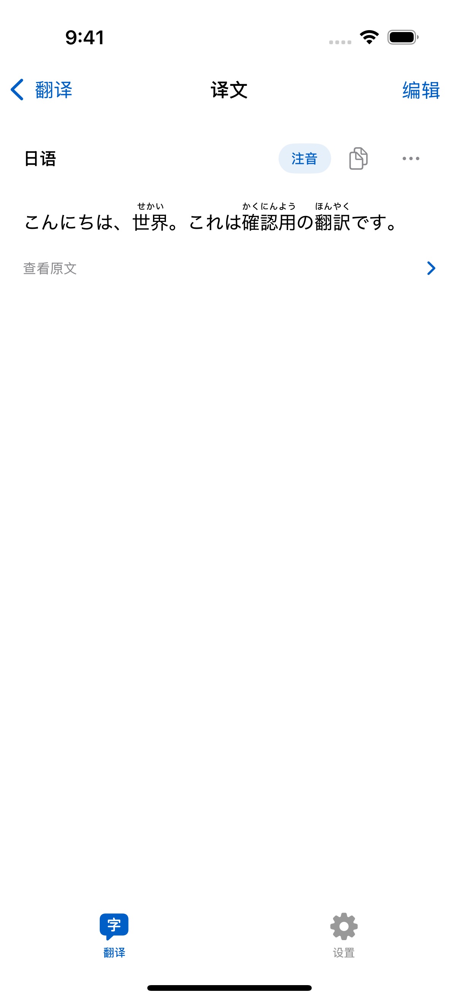

# 读屏 1.2.1（24）

## 页面与交互

- 翻译页采用原生导航大标题与系统灰白背景，语言、输入、照片、相机、粘贴和翻译操作形成一个连续区域。
- 删除右上角重复的历史按钮，完整记录统一从“最近翻译 → 查看全部”打开，保留搜索、详情、删除与清空。
- 最近翻译只展示实际保存的记录，清空记录后同步更新；保留当前正在编辑的原文。
- 输入工具采用至少 44 点触控区域，翻译使用原生突出按钮。辅助功能大字号下语言选择、底部操作和记录标题纵向排列，导入图标统一缩放。
- 独立阅读页保持简洁；日语注音仅出现在日语结果旁，字号与段落设置仍在设置页调整。复制结果后提供勾选与触感反馈。
- 设置首页使用原生分组列表、系统字号、分类图标和原生导航，底部署名 Jerry Wong。
- 支持原有浅色、深色、强调色与自定义主题，保留已保存的 API、语言、记录和阅读偏好。

## 设计依据

参考苹果 [Layout](https://developer.apple.com/design/human-interface-guidelines/layout) 中的视觉层级、相关内容分组和渐进展示建议，使用当前 iOS 18 SDK 提供的原生导航、列表、菜单和按钮。

## 验证范围

本轮使用 iOS 18.2 模拟器和隔离测试数据，不访问外部翻译服务。真机测试按此前要求继续暂停。最终测试与安装包校验记录保存在 `work/release-1.2.1/`。

## 页面预览

以下均为模拟器实际截图，内容来自隔离测试数据。

| 翻译主页 | 设置首页 | 日语阅读 |
| --- | --- | --- |
|  |  |  |

## 安装包

- 文件：`work/release-1.2.1/Screenreader-iOS-v1.2.1-build24-unsigned.ipa`。
- 版本：1.2.1（24），iPhoneOS arm64，最低 iOS 18.0。
- 未签名 Release，需要签名后安装；保留原应用标识 `com.raydon.ScreenTranslate`。
- 文件大小：2,749,255 字节。
- SHA-256：`4b5a236bbba9b5970c1e6d24912861d06721e61be0a80a28fbd87ee29230b0b4`。
- 已校验版本、架构、ZIP CRC、无测试代码、无本地构建路径与未签名状态。

最终结果：158 项核心测试、16 项不同的模拟器界面用例通过，iPhoneOS Release 构建通过。界面用例按所选回归与视觉修复后复测的最后结果去重统计，本轮未运行完整界面测试集。逐项结果见 [验证报告](验证报告.json)。
