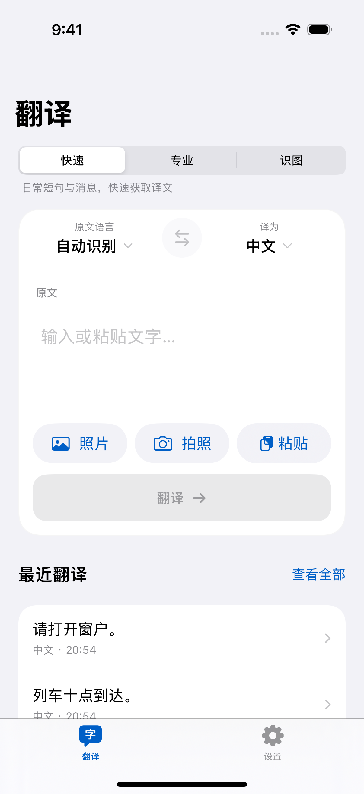
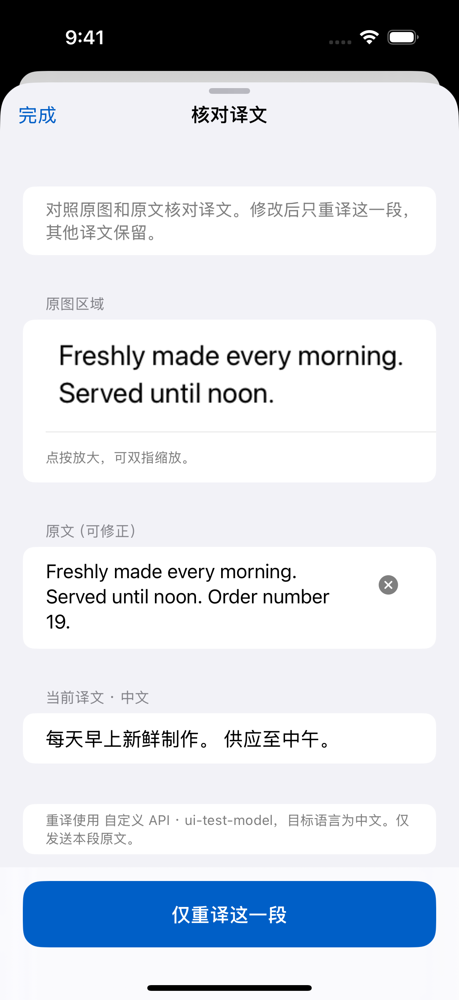
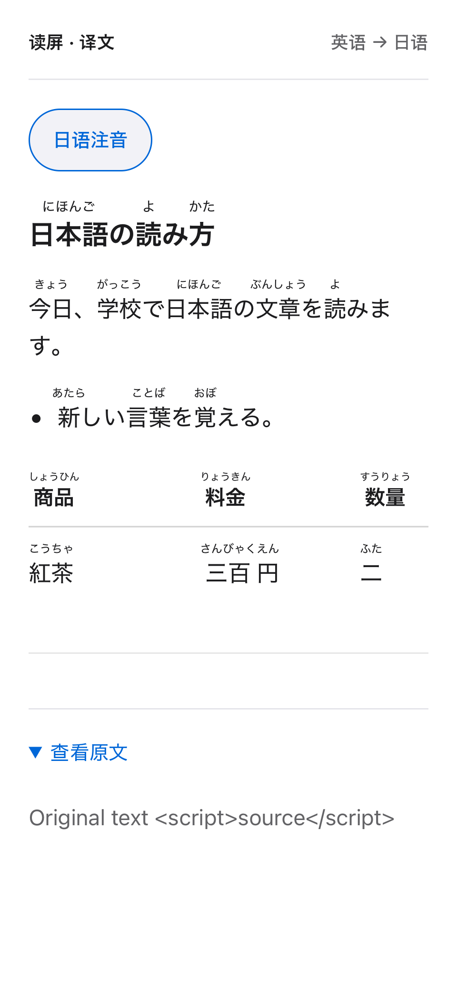

# 读屏 1.2.1（25）· 页面与交互优化

更新日期：2026 年 11 月 9 日。

## 主屏与按钮

语言区明确区分“原文语言”和“译为”，模式下方提供简短用途说明。输入区保留自然高度；照片、拍照、粘贴使用统一的带文字入口，整行翻译按钮作为主要操作。最近翻译仍只有一个完整历史入口。

粘贴使用 iOS 原生 UIPasteControl，只在用户操作后接收内容；识图模式只接受图片。它与照片、拍照共用中性底色，支持系统字号和深色模式。字号与排版设置继续留在设置页，日语注音只出现在日语结果中。收起键盘后，原文输入区不再拦截页面的上滑手势，大字号时可正常滚动到下方操作。

## 弹窗与阅读

- 历史和核对窗口采用原生大尺寸浮层，显示拖动提示；翻译信息支持中等和大尺寸。
- 核对窗口的“仅重译这一段／行”位于底部安全区域，键盘和滚动内容不会遮住操作。请求中可取消；失败后保留修改草稿与原译文。
- 正文恢复正常的点选与阅读行为，通过明确的“核对”按钮打开复核，减少误触弹窗。
- 快捷指令全文窗口显示简洁的语言信息、统一对齐的日语注音开关和完整译文；原文放到文末展开。表格保留横向滚动，内容全部按文字转义，不运行模型输出，也不依赖网络资源。
- 快捷指令的外层关闭按钮、窗口高度和工具栏继续由 iOS Quick Look 管理。

## 翻译与返回逻辑

点击“翻译”后直接进入阅读页，显示当前步骤和耗时。返回主屏后任务继续，可查看进度或取消；翻译完成不会强行打开页面或打断历史弹窗。原文未改变时，主按钮显示“查看译文”，可重新打开当前结果，包括未保存为历史的结果。

整篇和逐段主动重译均跳过旧译文缓存，成功后更新缓存，继续保留本机识字复用。整篇重译期间保留旧译文；取消或失败也保留旧译文与原文，失败时提供重试按钮。重复点击不会启动并行请求，已取消请求的延迟响应不能覆盖新输入或写入记录。

旧版截图预览和文字快捷指令遇到错误时明确中止并显示可读原因，不再返回空字符串作为成功结果，避免后续快速查看或复制收到空白内容。现有三种 App Intent 和两份已签名快捷指令资源保持兼容。

## 验证边界

本轮使用 Xcode 16.2、iOS 18.2 模拟器和隔离测试内容。请求成功、延迟、失败和取消由本地测试服务模拟；Vision 与 WebKit 使用实际系统框架。本轮不验证外部模型的译文质量，未恢复此前暂停的真机测试，未进行相机实拍、真机操作按钮或系统语言包下载测试。

安装包为 iPhoneOS arm64 未签名 Release，需要签名后安装。最低 iOS 18.0，应用标识保持 `com.raydon.ScreenTranslate`，开发者署名 Jerry Wong。

设计参考：[Apple Buttons](https://developer.apple.com/design/human-interface-guidelines/buttons)、[Apple Sheets](https://developer.apple.com/design/human-interface-guidelines/sheets)。

## GitHub 设计参考

按本轮追加要求，实际查看了以下项目的 README 和界面代码，参考交互和排版方式，以本项目原生控件实现：

| 项目 | 查看内容 | 在读屏中的应用 |
| --- | --- | --- |
| [IceCubesApp](https://github.com/Dimillian/IceCubesApp) | [原生工具栏](https://github.com/Dimillian/IceCubesApp/blob/main/Packages/DesignSystem/Sources/DesignSystem/Views/StatusEditorToolbarItem.swift)、[错误状态](https://github.com/Dimillian/IceCubesApp/blob/main/Packages/DesignSystem/Sources/DesignSystem/Views/ErrorView.swift) | 轻量辅助操作；首次翻译失败采用原生状态页，给出原因和明确重试入口；保留已生成译文时使用紧凑提示 |
| [Translate Screen](https://github.com/0xffvirus/translate-screen) | [主页和语言分组](https://github.com/0xffvirus/translate-screen/blob/main/ScreenTranslate/ContentView.swift) | 系统分组背景、带说明的语言选择、连续圆角与主次操作层级；避免将图片导入按钮与翻译主操作混为同一视觉层级 |
| [SwiftUITranslation](https://github.com/dougholland/SwiftUITranslation) | [系统翻译呈现示例](https://github.com/dougholland/SwiftUITranslation/blob/main/SwifUITranslation/TranslationPresentationView.swift) | 对照由用户操作驱动呈现的方式；读屏继续保留自己的三模式流程和可复核阅读页 |

这些参考未作为新依赖引入，未复制项目代码或素材。仍使用本项目的 iOS 18 兼容实现。

## 最终验证与安装包

158 项核心测试、24 项不同的 iOS 集成用例、18 项不同的界面用例最终通过。集成与界面共执行 60 次（含定向复测），按每个用例最后结果去重，未声称运行完整 iOS 测试集。大字号测试曾发现输入框拦截页面滑动，修复后使用原断言复测通过。

iPhoneOS Release 构建通过；版本、架构、ZIP CRC、三种 App Intent、快捷指令资源、未签名状态、测试代码和本机构建路径排除检查均通过。逐项结果见 [验证报告](验证报告-构建25.json)。

- 文件：`work/interaction-polish/Screenreader-iOS-v1.2.1-build25-unsigned.ipa`
- 大小：2,778,225 字节。
- SHA-256：`0280c322090da63e51b89603367b7dd83f260874c7e4b2a5b40bc8afcd6b6aca`。

## 实际界面预览

均为模拟器与 WebKit 的实际截图，内容为隔离测试数据。

| 主页 | 核对弹窗 | 全文阅读窗口 |
| --- | --- | --- |
|  |  |  |

[深色大字号操作](assets-build25/dark.png) · [首次失败与重试](assets-build25/error.png)
