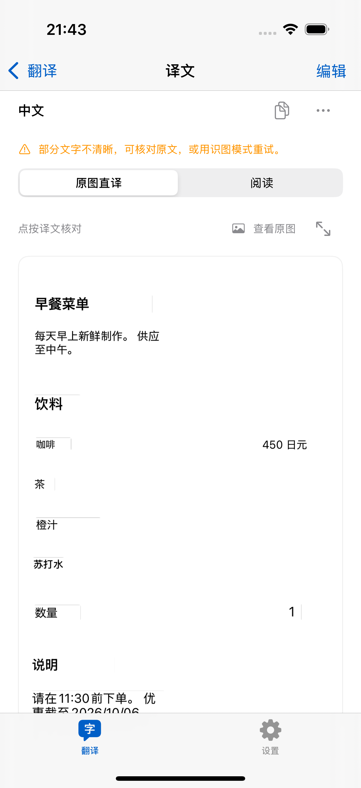

# 读屏 1.3.0（26）

日期：2026-11-09。开发者：Jerry Wong。最低 iOS 18.0。

## 使用方式

选择照片、拍照或粘贴图片后，使用快速或专业模式翻译。结果页默认显示“原图直译”，也可切换为“阅读”。本机系统翻译在 App 内同样保留图片文字的位置。

点“查看原图”对照原始图片，点右侧放大按钮进入全屏，支持双指缩放。点按任意译文，查看完整内容和对应原文。AI 翻译支持修改原文后只重译该段或表格行；系统翻译可核对，修改时返回原文页后重新翻译。

已有“读屏全文”或“屏译全文”快捷指令不需要重建。截图翻译完成后，快速查看文档中也可以切换原图直译、阅读和原图对照，点按文字查看完整对应内容。

## 排版与交互

- 本机 OCR 决定段落、表格单元格、价格字段和竖排列的位置。模型只返回编号对应的译文，不决定坐标。
- 快速图片翻译采用一次分段请求，保留段落及数字校验。纯文字快速翻译保持原来的简洁输出。
- 系统翻译按编号还原批量结果，保留重复段落、空单元格和列数；缓存区分带坐标的图片结构与纯文字。
- 中日文竖排列沿用原图方向；英语采用横排。表格和菜单价格分别对齐，不随整行左移。
- 原图模式按区域适配字号；超过可显示范围时提供提示，点按查看完整译文。阅读模式继续使用用户设置的字号、字体、行距和段距。
- 日语假名注音沿用 App 内开关。快捷指令结果也能独立切换注音。
- 翻译失败保留上次结果；局部修正保留对应位置；清空、修改原文或更换图片后不会复用旧图上的文字位置。

## 数据与适用范围

原图直译显示的是翻译后的截图，关闭后回到原 App 继续操作。滚动原页面后需要重新截取。识图模式产生的画面说明没有可靠的逐段对应位置，使用阅读界面。

快速和专业模式只向已配置的服务发送识别文字，原图显示在本机完成；识图模式沿用原来的压缩图片上传流程。本机翻译不调用外部翻译 API。

历史记录仍只保存文字与坐标，不保存截图；旧记录正常兼容。全文快捷指令结果为包含图片的独立 HTML 文件，不需要脚本或外部资源。分享该文档时会包含原图，App 内“分享译文”仍只分享文字。

实现参考 Translate Screen 的“截图、文字位置与覆盖译文”流程，使用本项目现有 OCR、翻译、核对和缓存能力独立实现，未引入第三方代码或依赖。

## 验证与交付

最终验证结果与安装包校验见同目录的验证报告。测试覆盖真实 Vision 识字、模拟 API 结果、WebKit 文档与 iPhone 模拟器交互。真机测试仍按此前要求暂停；本轮未验证真实服务商输出质量、真机语言包下载或相机实拍。

基本检查已完成：166 项核心检查、59 项 iOS 集成检查和 11 项已完成的界面检查通过，其中原图直译 4 项界面用例均通过。用户要求简单检查后交付，剩余大范围回归已停止。旧界面用例有一处仍断言旧版本号 1.2.1，已更新为 1.3.0；未把它记为已通过。

iPhoneOS Release 构建、arm64 架构、版本号、资源、未签名状态、测试代码排除及 ZIP CRC 校验通过。

安装包：`Screenreader-iOS-v1.3.0-build26-unsigned.ipa`，2843430 字节。未签名，需要自行签名安装。

SHA-256：`d0684b2b34218fa32839afedb55742ad1ddfe07e21555513899e1b35233426c2`。

[阅读模式](assets/reading.png) · [点按核对](assets/review.png) · [竖排显示](assets/vertical.png)

预览为模拟器中的隔离测试内容，不代表真实服务商翻译质量。

## 构建 27 · 2026-11-10

在 iOS 18.2 的系统「快速查看」中，点按译文时，页内链接会触发离开快捷指令的系统提示。构建 27 改用文档内的控件，点按后在当前窗口展开核对。

模拟器已通过 7 项 App 界面补充检查、构建 27 的 6 项图片翻译集成检查，以及系统快捷指令从导入到关闭后再次运行的完整检查。翻译使用固定测试返回。

新安装包为 `Screenreader-iOS-v1.3.0-build27-unsigned.ipa`，需签名安装。SHA-256 为 `cb94328f9e894daac6fdd0dabc17b05bca6a81f1f260a22d44d3aba882750370`。
