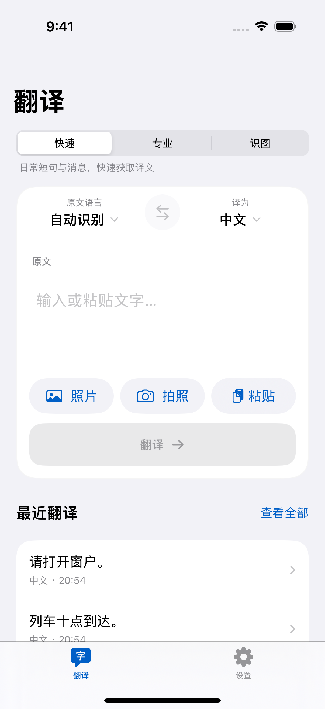
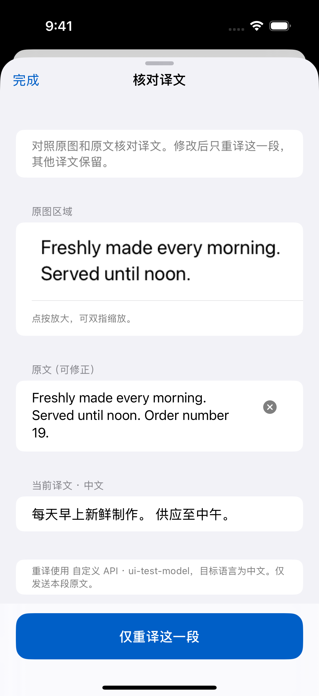

# 读屏 Screenreader

> [!IMPORTANT]
> **本 APP 由 Claude Fable 5.2 及 Opus 5.5 开发完成。**

读屏是一款面向 iPhone 的截图、文字与图片内容翻译 App。长按操作按钮即可截屏、翻译并打开可滚动的全文窗口，也可以在 App 内输入文字、拍照、选择照片或粘贴文字和图片。App 界面为中文，支持中文、英语、日语互译与混合语言识别。

| 平台 | 当前版本 | 开发者 | 许可 |
|---|---|---|---|
| iOS 18+（iPhone） | 1.4.0（build 33） | Jerry Wong | [MIT](LICENSE) |

## 主要功能

### 三种翻译模式

| 模式 | 适用内容 | 当前功能 |
|---|---|---|
| 快速 | 普通文字、网页和短消息 | 精简 API 翻译，优先速度，保留全文和关键事实；App 内另可选 Apple 系统翻译 |
| 专业 | 菜单、商品、通知与表格 | 保留标题、段落、列表、字段、商品与价格关系，以及表格列归属 |
| 识图 | 照片、海报和难以识字的图片 | 分别说明可辨认文字的大意与整体画面内容，可发送同图局部细节辅助理解 |

可以事先选择默认模式，也可让操作按钮每次询问。识图需要实际支持图片的 API 模型；系统翻译仅支持 App 内快速模式，操作按钮使用 API。

### 语言优先级

- 原文语言选“自动识别”、内容又已经是所选的目标语言时，按优先顺序改译成另一种语言。默认顺序是 中文 › 日语 › 英语：目标语言是中文时输入中文，译成日语。
- 顺序在“设置 → 翻译偏好 → 语言优先级”里拖动调整，也可以关掉“自动改译”。所选的目标语言不会被改掉。
- 翻译页在发送前就显示“按优先级译为 日语”，结果上方写明原因。手动指定了原文语言，或者内容是中日文分量相当的混排、繁体中文时，都按所选的目标语言翻译。
- 截图、照片、操作按钮和识图按画面的主要内容判断，链接、@账号和界面上的短标签不算：中文手机上的日语截图、目标是日语时，译成中文。主要内容是排在第一位的语言（默认中文）时，要整张都是这种语言才改译，以免漏译夹在里面的外语。
- 判断在本机完成，不发请求。规则和例子见 [1.3.4 更新说明](Docs/Release-1.3.4/更新说明.md) 和 [1.4.0 更新说明](Docs/Release-1.4.0/更新说明.md)。

### 识字与专业排版

- 在本机识别截图文字，支持长图切片和模糊区域有限次放大复识别。
- 根据位置及邻近文字处理状态栏、导航图标、装饰和孤立符号，保留有意义的数量、价格、日期、评分、表情和数学符号。
- 专业模式恢复标题层级、正文段落、列表及表格关系，避免商品与价格、数量与库存错位。
- 处理多余换行、标点空格、重复项目符号和无意义的整段 Markdown 包装；保留编号、小数、日期和表情组合。
- 校验专业结果的段落与数字完整性，遇到漏段、关键数字丢失或接口截断时明确报错。

日语场景强化税费、期限、否定、套餐与单品、退款条件、必选项和脚注处理。选择的来源语言会同时用于识字与翻译，目标语言会更新默认指令和提示词变量。

### 译文直接核对

专业译文可点按段落或表格行旁的“核对”，查看对应原文和原图区域，并放大原图。原文修正后只重译这一段或这一行；其余译文、段落样式及表格列归属保留。更新同时应用到原文输入框和已有翻译记录，下次整篇翻译继续使用修正后的原文。

表格按列编辑，保留空列与列数，继续校验各单元格的数字。失败或取消保留旧译文，核对历史译文保持原来的来源及目标语言，使用当前配置的 API 与术语要求。记录不保存图片，历史核对仅展示原文；旧记录缺少段落对应关系时仍可展开全文原文。当前功能未使用需要新 SDK 的 `RecognizeDocumentsRequest`。

使用与验证范围见 [译文核对功能说明](Docs/Release-1.1.1/译文核对功能说明.md)。

### 日语注音

- “设置 → 外观与阅读 → 译文显示 → 日语假名注音”与日语译文标题旁的“注音”共用一个开关，默认关闭，自动保存。
- 开启后，日语译文的汉字上方显示居中的平假名，字号为正文的一半；保留词中的原有假名。段落、列表、表格、翻译记录及核对页面同步适用。
- 本机生成并缓存读音，切换不重新翻译，不增加 API 请求。复制、分享、历史存储仍保留纯译文。
- 快捷指令的全文窗口也提供“日语注音”开关，初始状态遵循 App 设置；该窗口内的临时切换不改变 App 设置。
- 读音来自系统词典，无法确定对应位置时不强行注音；姓名、多音字和特殊读法仍需结合上下文核对。

### 操作按钮与全文阅读

已提供完整的 **截屏 → 翻译截图全文 → 快速查看** 快捷指令。结果窗口可上下滚动阅读全文，展开“查看原文”核对识别内容。已有“屏译全文”指令保持兼容。

App 内和全文文稿可设置字体、字重、字号、行距、段距与原文默认展开状态。复制、分享和翻译记录均保留完整译文。

### API 与模式提示词

- 预设 Claude、ChatGPT、DeepSeek、通义千问、豆包、Kimi、智谱 GLM、MiniMax 和 Gemini；其他服务用“自定义”填写 HTTPS 地址，可以添加多个。
- 每个供应商可以留多个模型：勾选预设、从服务返回的列表里选，或手动填写模型 ID；实际可用的模型由服务账户决定。
- 支持 OpenAI 兼容（Chat Completions）、OpenAI Responses 和 Claude 兼容（Messages）三种接口格式，按模型分别保存；密钥按供应商保存在 Keychain。
- “换模型”在所有填了密钥的供应商之间切换正在用的模型。
- 快速、专业、识图各有独立默认提示词，也可分别填写、保存和重置自定义要求。
- 自定义要求支持 `{source_language}`、`{target_language}`、`{tone}`、`{glossary}` 变量及术语表；系统翻译不使用模型提示词。

### 缓存、记录与外观

相同文字、语言、模式、模型和有效提示词可在 **20 分钟**内复用内存缓存；相同图片也可复用文字和位置的识字结果，不缓存图片数据。支持关闭或清除两种缓存。识图解释不缓存，网络请求不自动重试。

翻译记录仅保存在本机，可保留 **10 / 30 / 100 条**，支持搜索、逐条删除及清空。关闭保存记录并保存设置后，已有记录也会清空。

支持浅色、深色、跟随系统及多种预设或自定义强调色。语言交换带轻量动效与触感反馈。设置首页集中提供翻译、API、模式提示词、外观与阅读、缓存与记录、操作按钮及使用说明。

<table><tr>
<td></td>
<td></td>
</tr></table>

## 下载与安装

安装包在 [GitHub Releases](https://github.com/WZR0821/Screenreader/releases/latest)。`Screenreader-iOS-v1.4.0-build33-unsigned.ipa` 是 iPhoneOS arm64 未签名 Release，需要自行签名后安装，最低 iOS 18。

### 开始使用

1. 在读屏 **设置 → AI 大模型 → 添加供应商** 中选一家服务，填写自己的 API Key 并添加。
2. 在 **设置 → 翻译偏好** 中选择来源、目标语言和默认模式，即可在 App 内翻译。
3. 如需长按操作按钮：在 **设置 → 操作按钮 → 安装“读屏全文”** 中添加快捷指令，再到 iPhone **设置 → 操作按钮 → 快捷指令** 选择“读屏全文”。

首次使用默认目标语言为中文，升级保留已经保存的语言选择，默认 API 配置为 DeepSeek / `deepseek-flash`。

解锁手机后打开待翻译页面，长按操作按钮，首次按提示授权并滚动阅读全文。没有操作按钮时，可从“快捷指令”App 运行或直接使用 App 内翻译。若重签名改变了应用标识，需要重新连接当前安装 App 的全文翻译动作。详见 [使用指南](Docs/Release-1.0.0/使用指南.md)。

## 数据与隐私

API Key 分服务保存在设备 Keychain。本机记录只保存文字结果，不保存截图；缓存仅在内存中保存。

快速和专业模式只向用户选择的 API 发送识别文字及翻译要求。识图会发送重新编码的图片与同图细节，不复制原图 GPS / 相机元数据。外部服务的数据政策由对应服务商决定。当前没有 App 自建业务服务器、广告或统计 SDK。详见 [隐私与数据处理](Docs/Release-1.0.0/隐私与数据.md)。

## 开发与构建

使用支持 iOS 18 SDK 的 Xcode 打开 `ScreenTranslate.xcodeproj`，选择 `ScreenTranslate` scheme。验证环境为 Xcode 16.2 / iOS 18.2 模拟器。应用使用 SwiftUI、Vision、App Intents 和 Apple Translation，没有第三方包依赖。

```sh
python3 Scripts/generate_project.py
swift test

xcodebuild build -project ScreenTranslate.xcodeproj -scheme ScreenTranslate \
  -configuration Release -sdk iphoneos -destination 'generic/platform=iOS' \
  -derivedDataPath work/DeviceBuild CODE_SIGNING_ALLOWED=NO

python3 Scripts/package_unsigned_ipa.py \
  work/DeviceBuild/Build/Products/Release-iphoneos/ScreenTranslate.app \
  work/release-1.4.0/Screenreader-iOS-v1.4.0-build33-unsigned.ipa
```

在模拟器上跑测试时，测试包要让 Xcode 正常做本地签名（不要加 `CODE_SIGNING_ALLOWED=NO`）；否则 App 读写不了钥匙串，测试数据存不进去，依赖 API Key 的测试会失败。本仓库在 iCloud 同步的 `~/Documents` 里，放在仓库内的编译产物会带上扩展属性，codesign 会报 `resource fork, Finder information, or similar detritus not allowed`。所以测试编译目录要放在 iCloud 之外：

```sh
xcodebuild build-for-testing -project ScreenTranslate.xcodeproj -scheme ScreenTranslate \
  -configuration Debug -destination 'generic/platform=iOS Simulator' \
  -derivedDataPath /Users/Shared/ScreenreaderBuilds/1.4.0-test -jobs 2
```

各版本的测试范围和结果见 [更新记录的“各版验证记录”](Docs/CHANGELOG.md#各版验证记录)。

更多说明：[功能与开发总结](Docs/Release-1.0.0/开发总结.md) · [使用指南](Docs/Release-1.0.0/使用指南.md) · [架构与 API](Docs/Release-1.0.0/架构与API.md) · [后续路线](Docs/Release-1.0.0/开发路线.md)

## 项目结构

| 目录 | 用途 |
|---|---|
| `ScreenTranslate/` | iOS App：`Core/` 是识字整理、排版、提示词和翻译请求的逻辑，`Services/` 是识字、图片处理、设置与钥匙串，`Views/` 是界面，`Intents/` 是快捷指令动作 |
| `Tests/` | 核心检查（`ScreenTranslateCoreTests`）、iOS 单元与集成测试（`iOSTests`）、界面测试（`UITests`）和测试素材 |
| `Scripts/` | 生成 Xcode 工程（`generate_project.py`）、打未签名 IPA（`package_unsigned_ipa.py`）和生成区分中日文用字的字表（`generate_language_tables.py`） |
| `Docs/` | 各版本的更新说明、验证记录和使用文档 |
| `Package.swift` | 让 `swift test` 在本机直接跑核心检查的 Swift 包 |

版本号在 `Scripts/generate_project.py` 里维护，改后重新生成工程。

## 版本记录

- **1.4.0（33）**：操作按钮、截图和识图也按语言优先级改译：按画面的主要内容判断，链接和界面上的短标签不算。和早先的内部测试包 1.4.0（28）无关。[更新说明](Docs/Release-1.4.0/更新说明.md)
- **1.3.4（32）**：语言优先级。自动识别出原文已经是目标语言时，按 中文 › 日语 › 英语 的顺序改译成另一种语言；顺序可调，可关闭。[更新说明](Docs/Release-1.3.4/更新说明.md)
- **1.3.3（31）**：截图翻译默认只出文字，“原图直译”改成默认关闭的开关；快速模式提速；原图直译按原文的行位和颜色排。[更新说明](Docs/Release-1.3.3/更新说明.md)
- **1.3.2（30）**：“API 设置”换成“AI 大模型”，按供应商保存密钥、地址和模型；翻译和设置两个主界面排满一屏。[更新说明](Docs/Release-1.3.2/更新说明.md)
- **1.3.1（29）**：设置即选即生效，删除记录前先确认，设置首页改为系统“设置”样式；并入原定为 1.4.0 的长文分段、报错原话、思考强度和流式显示（构建 28）。[更新说明](Docs/Release-1.3.1/更新说明.md)
- **1.3.0（27）**：原图直译，译文覆盖在原图的位置上，可随时切换“阅读”。[更新与验证说明](Docs/Release-1.3.0/更新说明.md)
- **1.2.1（24–25）**：界面与交互优化。[更新说明](Docs/Release-1.2.1/更新说明.md) · [构建 25 说明](Docs/Release-1.2.1/界面与交互-构建25.md)
- **1.2.0**：默认译为中文，单行语言菜单，译文显示设置，识字结果复用；构建 22 起加入日语注音。[更新说明](Docs/Release-1.2.0/更新说明.md)
- **1.1.1**：按 iPhone 上的真实网页测试修复识字与排版问题；构建 20 起专业译文可以逐段核对。[测试与修复报告](Docs/Release-1.1.1/测试与修复报告.md)
- **1.1.0**：拍照、系统粘贴、竖排日语重排、3–8 列表格、本机语言包管理。[更新与使用说明](Docs/Release-1.1.0/更新与使用说明.md)
- **1.0.0（17）**：首个公开版本。[功能与开发总结](Docs/Release-1.0.0/开发总结.md)

每一版的完整要点见 [更新记录](Docs/CHANGELOG.md)，安装包见 [Releases](https://github.com/WZR0821/Screenreader/releases)。

## 已知限制

- 翻译范围为提供的截图，不会自动滚动原 App 获取屏外内容。
- 模糊、微小竖排和艺术字可能识别不全；可明确选择识图重试，模型也不应猜补无法辨认的文字。
- 全文窗口使用系统 Quick Look，其关闭工具栏、推荐应用和高度由 iOS 控制。
- Apple 系统翻译在 App 前台运行，可能需要下载语言包；操作按钮使用已配置 API。
- 只提供未签名 IPA，安装前要自己签名。
- 语言优先级靠本机判断原文语言：键盘输入的日语词如果只有中日文共用的汉字（“山田”“学生”），默认顺序下会被当成中文；少于 20 个字母的拉丁字母内容一律当成英语。翻译页在发送前会显示实际译成什么。截图和识图按本机识字的结果判断，整屏都是很短的消息时可能判断不出来，照常按所选的目标语言翻译。
- 1.3.3 到 1.4.0 的回归都在模拟器上完成，没有上真机；1.3.3 的提速没有用真实密钥计时，1.3.2 新增的供应商和 1.3.4、1.4.0 的改译也没有用真实密钥连过。

## 许可与致谢

读屏自身的代码以 [MIT 许可证](LICENSE) 开源，没有第三方包依赖。Logo 和合成测试图由内置生图工具生成，具体生图模型版本未披露；测试素材仅用于开发回归。
